<!-- Cards live in /cards. Ink #111111 and electric blue #2F55FF, with light
     paper neutrals. Keep this block free of blank lines so the cards stay flush.
     The submission grid is regenerated daily by .github/workflows/leetcode-heatmap.yml. -->

<a href="https://yash-chaturvedi-portfolio.vercel.app/">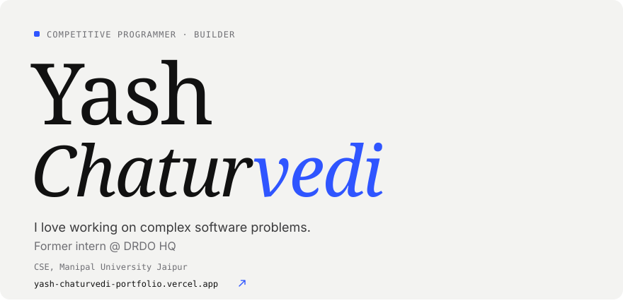</a> 
<a href="https://leetcode.com/u/Oru388f3ta">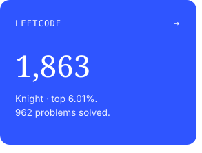</a><a href="https://codeforces.com/profile/yashchat007">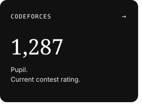</a><a href="https://takeuforward.org/profile/astrofantom">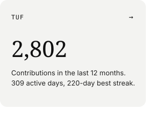</a> 
<picture><source media="(prefers-color-scheme: dark)" srcset="./cards/title-board-dark.svg" /></picture> 
<a href="https://leetcode.com/u/Oru388f3ta">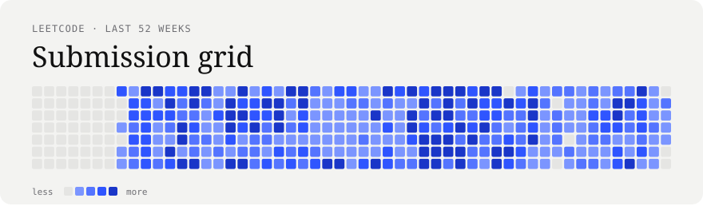</a> 
<picture><source media="(prefers-color-scheme: dark)" srcset="./cards/title-building-dark.svg" /></picture> 
<a href="https://github.com/yashchat007/graphite">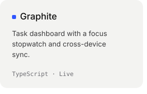</a><a href="https://github.com/yashchat007/RoleRadar">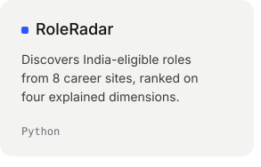</a><a href="https://github.com/yashchat007/friday">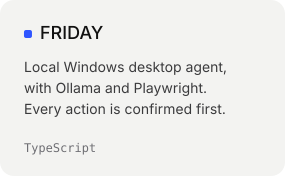</a> 
<a href="https://github.com/yashchat007/gesture-control">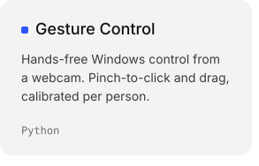</a><a href="https://github.com/yashchat007/constellation">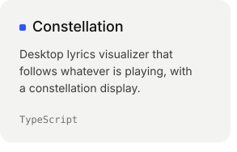</a><a href="https://github.com/yashchat007/CineCircle">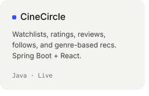</a> 
 
<a href="https://yash-chaturvedi-portfolio.vercel.app/">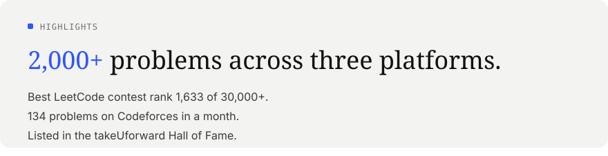</a>

<a href="https://yash-chaturvedi-portfolio.vercel.app/">portfolio</a> &nbsp;/&nbsp; <a href="https://www.linkedin.com/in/yash-chaturvedi-880032378/">linkedin</a> &nbsp;/&nbsp; <a href="mailto:yashchat007@gmail.com">email</a> &nbsp;/&nbsp; <a href="https://yash-chaturvedi-portfolio.vercel.app/Yash_Chaturvedi_Resume.pdf">résumé</a>

